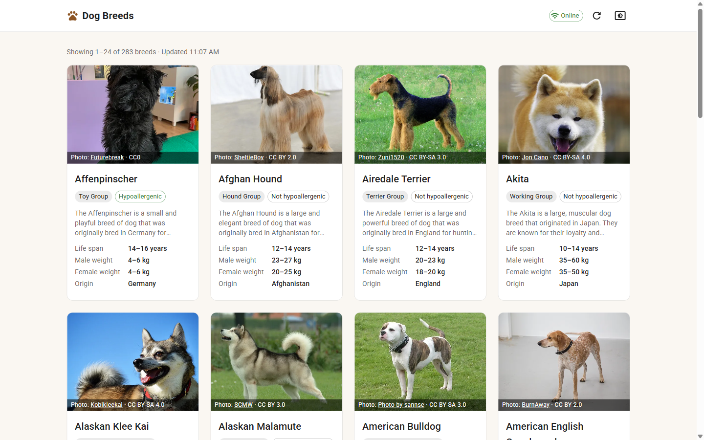
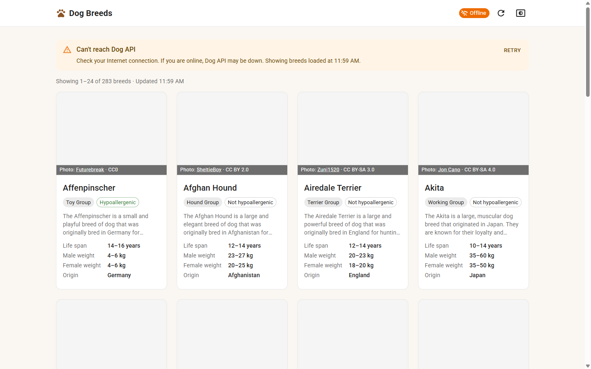
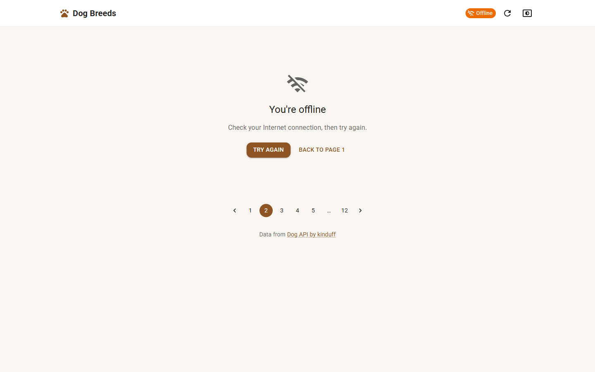
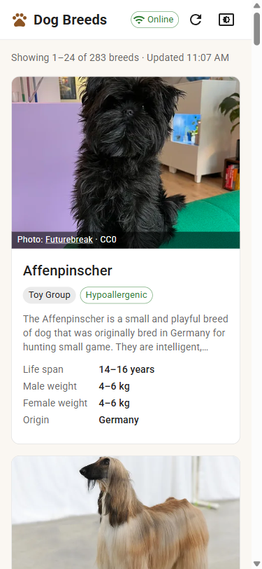
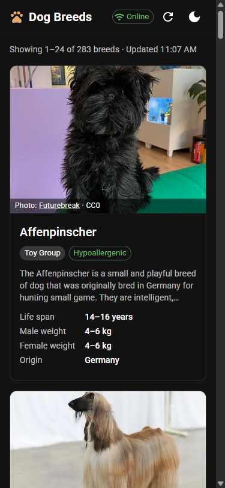

# Dog Breeds — React + Redux Toolkit

A React app with a Redux setup that calls the [Dog API](https://dogapi.dog/docs/api-v2) `GET /breeds` endpoint, shows information for each breed, and handles the request failing when the Internet is disconnected.

| Online | Offline: reload fails, loaded data stays |
|---|---|
|  |  |

| Offline: page that was never loaded | Mobile (light / dark) |
|---|---|
|  |   |

## Requirements → implementation

| Exam requirement | What happens | Where |
|---|---|---|
| 1. Call API get all breeds and display information for each breed (online) | `fetchBreeds` thunk calls `GET /breeds?page[number]=N&page[size]=24&include=group`. Each card shows photo, name, group, hypoallergenic, description, life span, male/female weight and origin. 283 breeds over 12 pages. | `src/features/breeds/breedsThunks.ts`, `src/features/breeds/components/BreedCard.tsx` |
| 2. Disconnect from the Internet, then call API get all breeds | The request is still sent and fails (`net::ERR_INTERNET_DISCONNECTED`). The thunk dispatches `breeds/fetchBreeds/rejected` with `{ kind: 'offline' }` (or `'network'`, see below). The UI shows the error and a Retry button. Breeds already on screen stay visible. The header chip switches to **Offline**. Retry / Reload calls the API again; when the browser reports that the connection is back, the app retries by itself. | `src/api/httpClient.ts`, `src/features/breeds/breedsSlice.ts`, `src/app/listenerMiddleware.ts` |

## Getting started

Requires Node.js 22+.

```bash
npm install
npm run dev        # http://localhost:5173
npm test           # unit + integration tests (Vitest)
npm run build      # type check + production build
npm run lint       # oxlint
```

## How to test the offline scenario

1. Run `npm run dev`, open the app and wait for the breeds to load.
2. Disconnect from the Internet in one of two ways:
   - **Turn off Wi-Fi.** You can also refresh the page (F5): the app is served from `localhost`, so it still opens, and the API call fails.
   - **Chrome DevTools → Network → "Offline".** Do **not** refresh here: DevTools offline mode also blocks `localhost`. Use the app's **Reload** button (⟳ in the header) or change page instead.
3. Click **Reload** (or go to another page) to call the API again.
4. Expected results:
   - The header chip shows **Offline**.
   - Reloading the current page shows a warning, and the loaded breeds stay on screen.
   - Opening a page that has not been loaded shows a full-page error with **Try again**.
   - DevTools → Network shows the failed request. Redux DevTools shows `breeds/fetchBreeds/rejected`.
5. Reconnect, then click **Retry** (or wait: if the browser fires its `online` event, the app retries by itself). The breeds load again, and photos that failed are requested again.

> **"I turned Wi-Fi off but the error says 'Can't reach Dog API', not 'You're offline'."** The browser only reports "offline" (`navigator.onLine === false`) when *every* network adapter is down. A VPN (Tailscale, Radmin, …), Hyper-V/WSL or VirtualBox adapter stays "connected" with Wi-Fi off, so the browser still says "online" and never fires its `offline` / `online` events. The app does not rely on those events alone:
> - The chip switches to **Offline** as soon as a request fails to reach the server, and back to **Online** after the next successful one.
> - No `online` event arrives when Wi-Fi comes back, so click **Retry**.
>
> The message only differs because the browser cannot tell "no Internet" from "server down" in that case.

> **"Refresh while offline shows the browser's own 'No internet' page."** This means the browser could not download the app itself (HTML/JS), so no app code ran yet. It is expected when DevTools is set to "Offline" (it blocks `localhost` too), or when the app was opened through the Network address Vite prints (`http://192.168.x.x:5173`) and Wi-Fi was then turned off. Open `http://localhost:5173` instead, or use the in-app **Reload** button. Opening a deployed site after a refresh while offline would need a Service Worker (PWA). This exercise does not ask for that.

## Tech stack

React 19 · TypeScript 7 · Redux Toolkit 2 + React Redux 9 · MUI 9 (responsive layout, dark mode) · Vite 8 · Vitest + Testing Library · oxlint

## Project structure

```
src/
├─ main.tsx                    Entry: <Provider store> + <ThemeProvider>
├─ App.tsx                     Root component: header + page + footer
├─ app/                        App-wide setup
│  ├─ store.ts                 combineReducers + configureStore, RootState / AppDispatch types
│  ├─ hooks.ts                 useAppDispatch / useAppSelector (typed hooks)
│  ├─ listenerMiddleware.ts    Retries the failed request when the connection comes back
│  └─ theme.ts                 MUI theme with light + dark color schemes
├─ api/                        The only code that talks to the server
│  ├─ httpClient.ts            fetch + timeout + no-cache + error classification
│  ├─ apiError.ts              ApiError type and user-facing error messages
│  ├─ dogApi.ts                getBreeds()
│  └─ dogApiTypes.ts           Raw Dog API response types (JSON:API)
├─ features/
│  ├─ breeds/                  Everything about the breed list
│  │  ├─ breedTypes.ts         App types: Breed, PaginationInfo
│  │  ├─ breedMapper.ts        Raw API data → Breed
│  │  ├─ breedsThunks.ts       fetchBreeds (createAsyncThunk)
│  │  ├─ breedsSlice.ts        State + pending / fulfilled / rejected reducers
│  │  ├─ breedsSelectors.ts    Selectors, incl. selectBreedsViewState
│  │  ├─ usePageFromUrl.ts     Current page stored in the URL (?page=2)
│  │  └─ components/           BreedsPage, BreedGrid, BreedCard, BreedImage, ...
│  └─ network/                 Online / offline status
│     ├─ networkSlice.ts
│     ├─ useNetworkStatusListener.ts
│     └─ components/NetworkStatusChip.tsx
├─ layout/                     App shell: AppHeader, AppFooter
├─ components/                 Generic reusable UI: StatusMessage, ColorModeToggle
└─ utils/formatters.ts         Pure helper functions

tests/                         All tests, kept out of src/ so the app code reads cleanly
├─ api.test.ts                 API layer: every failure → an error kind (offline, network, timeout, …)
├─ redux.test.ts               Redux: mapper, reducers, thunk (duplicate / out-of-order requests)
├─ app.test.tsx                Whole app, end to end: exam requirement 1 and 2
└─ support/                    Test setup, render helper, fetch mocks, API fixtures
```

Read the tests from top to bottom of the stack: `api` → `redux` → `app`. `tests/app.test.tsx` is grouped by exam requirement. The rules for what goes where (dependency direction, containers vs. presentational components, state placement) are in [CLAUDE.md §3](CLAUDE.md#3-architecture-and-coding-rules).

## Redux concepts in this project

| Concept | Role | In this project |
|---|---|---|
| Store | Single source of truth for app state | `app/store.ts`, one store with `{ breeds, network }` |
| Action | Plain object `{ type, payload }` describing what happened | `breeds/fetchBreeds/pending` · `/fulfilled` · `/rejected`, `network/networkStatusChanged` |
| Reducer | Pure function `(state, action) => newState` | `breedsSlice.ts`, `networkSlice.ts` |
| `combineReducers` | Merges reducers into one root reducer | `app/store.ts` |
| `dispatch` | Sends an action to the store | `dispatch(fetchBreeds({ page }))` in `BreedsPage.tsx` |
| Middleware | Runs between `dispatch` and the reducers | redux-thunk (included by `configureStore`) + listener middleware (`app/listenerMiddleware.ts`) |
| `useSelector` / `useDispatch` | Read state / send actions from components | `useAppSelector` / `useAppDispatch` in `app/hooks.ts` (same hooks, pre-typed) |
| `createAsyncThunk` | Async logic with generated pending / fulfilled / rejected actions | `breedsThunks.ts` |
| Selector | Reads (and derives) data from state | `breedsSelectors.ts` |

## Design decisions

- **`createAsyncThunk` instead of RTK Query.** RTK Query would handle loading, error and caching automatically. A thunk with explicit `pending` / `fulfilled` / `rejected` reducers makes the Redux flow visible, which is the point of this exercise.
- **Hooks instead of `connect`.** `connect` still works, but the React Redux docs now recommend `useSelector` / `useDispatch`.
- **Reducers stay pure.** No API calls, `Date.now()` or browser APIs inside reducers. The timestamp is created in the thunk, and side effects run in the thunk and in the listener middleware.
- **Immer.** Code like `state.items = ...` inside `createSlice` looks like a mutation, but Immer produces a new state object. A test checks that the previous state is unchanged.
- **`fetch(url, { cache: 'no-cache' })`.** Dog API responses carry `cache-control: max-age=300, stale-while-revalidate=3600`. Without `no-cache`, the browser could answer from its HTTP cache while offline and the failure would never surface. With it, every call goes to the server, which answers `304 Not Modified` cheaply when nothing changed.
- **The request is sent even when `navigator.onLine` is `false`.** That way the API call really happens and visibly fails. `navigator.onLine` is only used to label the error as "offline" rather than "server unreachable".
- **Connection status comes from real requests too.** `navigator.onLine` and the `online` / `offline` events are unreliable on machines with VPN or virtual network adapters. The listener middleware therefore marks the app offline when a request cannot reach the server, and online again after a success.
- **No polling.** The app retries by itself only on the browser's `online` event. Otherwise the user clicks Retry. A background retry timer was tried and then removed: the exam does not ask for it, and it made the request flow harder to follow.
- **One request per page at a time.** The thunk's `condition` skips a request when the same page is already in flight, so the `online` event, a double click and React StrictMode can never send duplicates. Requests for different pages are allowed, and only the latest one updates the state.
- **Typed error kinds instead of raw messages.** Browsers word network errors differently ("Failed to fetch", "Load failed"…). Errors are classified as `offline`, `network`, `timeout` (10 s), `http`, `invalid-response` or `unknown`, and the UI shows a message for each kind.
- **Keep loaded data when a reload fails.** The user keeps seeing breeds, with a warning. Old data is only kept (while loading or after an error) if it belongs to the page in the URL, so the URL and the cards never disagree. Opening another page shows skeleton cards until it arrives.
- **Only the latest request updates the state.** Each `pending` stores its `requestId`, and late responses from older requests are ignored. This prevents a slow page-2 response from overwriting page 3.
- **State outside Redux, on purpose.** The current page lives in the URL (`?page=2`) so it survives a refresh, can be shared, and works with Back / Forward. MUI manages the color mode preference itself.
- **Page size 24.** It divides evenly into 1, 2, 3 and 4 columns, so grid rows are always full. The API omits `meta.pagination.last` on the last page, so the page count falls back to `ceil(records / pageSize)`.
- **Image credits.** Most photos are CC BY / CC BY-SA, which require attribution, so each card credits the author and license.

## Development process

This project was built together with an AI coding assistant (Claude Code). [CLAUDE.md](CLAUDE.md) records each step: the analysis, the decisions and why they were made, the checks against Redux theory, how the scope was kept in line with the exam, and how the result was verified.
